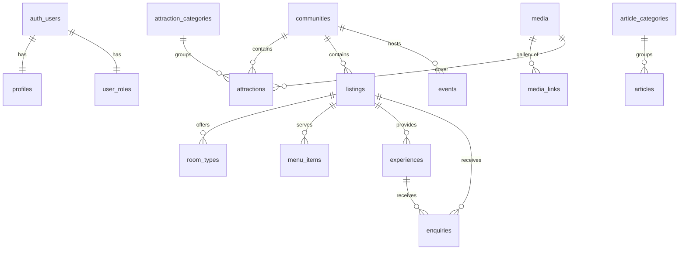

# Database schema (Phase 1)

Source of truth: `supabase/migrations/`. Seed (structure only, no invented facts): `supabase/seed.sql`.

## Tables
| Table | Purpose | Public read |
|---|---|---|
| `profiles`, `user_roles` | Person details; role (separate table so users cannot edit it) | Own row; staff read all |
| `communities` | Towns and villages (10 Lake Bosomtwe-area names seeded as **drafts**) | Published |
| `attraction_categories`, `attractions` | Directory of places to see | Published |
| `listings` | Hotels, restaurants, tour operators, guides, boats, artisans… (`type` enum) | Published |
| `room_types`, `menu_items` | Child data of a listing | If parent is published |
| `experiences` | Tours and activities; `provider_verified` gates "confirmed" claims | Published |
| `events` | Dated events; `event_status` separate from publication `status` | Published |
| `article_categories`, `articles` | Editorial; `published_at` in the future = scheduled | Published and date reached |
| `pages` | About, Explore, Travel Guide, Privacy, Terms (Markdown) | Published |
| `testimonials` | Only `is_verified` + published are shown | Verified + published |
| `media`, `media_links` | File metadata and gallery links | Yes |
| `enquiries` | Contact, booking requests, listing/partnership requests | **No** (insert only) |
| `newsletter_subscribers` | Email list | **No** (insert only) |
| `site_settings`, `homepage_sections` | CMS-managed configuration. Never store secrets here | Yes |
| `audit_logs` | Trigger-written change history | Admins only |
| view `public_authors` | Name/avatar of authors of published articles only | Yes |

## Conventions
- UUID primary keys; `created_at`/`updated_at` maintained by trigger.
- Soft delete via `deleted_at` on content tables; RLS hides soft-deleted rows from the public.
- `status`: `draft` → `pending_review` (in review) → `approved` → `published` → `archived`.
- Latitude/longitude are nullable with range checks. They are never defaulted or guessed.
- Currency columns default to `GHS`; no exchange rates are stored.
- `sources` (attractions/communities) is a **public** field shown on the page. RLS cannot hide single columns, so it is deliberately not an internal note.

## Row Level Security summary
| Actor | Can |
|---|---|
| Anonymous | Read published content; insert into `enquiries` / `newsletter_subscribers` (status forced to `new`) |
| Visitor / partner | Same as anonymous, plus read/update own profile and read own role |
| Content editor | Create/update content drafts and media; cannot approve, publish or verify; no deletes; cannot change `is_verified`, `is_featured`, `owner_id` on listings (DB triggers) |
| Regional editor | Content editor + approve, publish, verify, manage regions and districts |
| Media manager | Media library only |
| Admin | Regional editor + delete content, read audit log, manage settings, read users |
| Super admin | Admin + change user roles |

Verified by running both migrations plus an RLS test script (24 checks) against a throwaway Postgres: anonymous cannot read drafts, future-dated articles, unverified testimonials, enquiries, roles or audit logs; a visitor cannot promote themselves; an editor cannot delete or verify; only a super admin can change roles.

## Phase 2 additions (migration `20261109000001`)
| Item | Purpose |
|---|---|
| `subscription_plans` | Admin-editable plans (price optional, photo limit, featured/analytics flags) |
| `listings.plan_id` | Plan assigned by an admin |
| `profiles.business_account_type` | Partner type; set once |
| `listing_views` + `record_listing_view()` | Daily view counts; anyone can record a view of a published listing, only the owner/staff can read |
| `become_partner(type)` | visitor → partner, requires verified email; the only way to get the partner role |
| Policies | Owners read/insert/update own listings (cannot publish/verify/feature/plan), manage own rooms/menu/gallery, read enquiries about own listings, upload to `partners/<uid>/` |

## Phase 3 additions (migration `20261110000001`)
| Table / function | Purpose |
|---|---|
| `bookings` | Request-based bookings (accommodation, experience, table). Reference `VLB-XXXXXXXX`; price set only by provider/staff; status + payment status |
| `booking_status_history` | Every status change with actor |
| `booking_payments` | Gateway transactions (reference, amount, currency, method, provider response). Written only by server code |
| `room_blocked_dates` | Provider-blocked dates (availability). Active bookings also consume `room_types.units` |
| `reviews` | One per completed booking; moderated (`pending/published/rejected`); owner reply |
| `subscription_plans.commission_percent` | Commission recorded at payment time |
| Functions | `create_booking`, `set_booking_status`, `lookup_booking`, `guest_cancel_booking`, `submit_review`, `reply_to_review`, `can_manage_booking`, `room_available` |
| Access | No direct writes to booking tables. Customers see bookings by reference+email (or their account), providers see bookings for their own listings, staff see all |

## Phase 4 additions (migration `20261111000001`)
| Item | Purpose |
|---|---|
| `travel_itineraries` | A user's plan (days, travellers, interests, optional `share_token`). Owner-only; max 20 per user |
| `itinerary_items` | Items by day/order: a published attraction, listing, experience, event, community, or a custom line. Max 100 per plan |
| `itinerary_view(id, token)` | Resolves a plan for its owner or a share-token holder, against **published** content only (unpublished items show as "no longer available", no title) |
| `nearby_places(lat, lng, radius, limit)` | Great-circle distance search over published items that have coordinates |

## Phase 5 additions (migration `20261112000001`)
| Item | Purpose |
|---|---|
| `investment_opportunities` | Projects with `stage` (operational/approved/proposed/under_consideration). CHECK: approved/operational need `stage_source`; estimates need `investment_note` and min ≤ max |
| `enquiries.investment_id` | Investor enquiries point at a project |
| `advertisements` | Sponsored placements; visible publicly only when published and inside `starts_at..ends_at`; admins only can write |
| `record_ad_event()` | Only way to bump `impressions`/`clicks`; counts only live ads |

## Planned tables (later phases)
Phase 4: `travel_itineraries`, `itinerary_items`, `saved_places`. Phase 5: `investment_opportunities`, `investor_enquiries`, `advertisements`, `advertisement_campaigns`.

## VisitAsanteman Phase 1 additions (migrations `20261113000001` to `20261113000003`)
Geography: **Region → Administrative area (MMDA) → Community → Locality.** Traditional areas are a separate many-to-many overlay.

| Item | Purpose |
|---|---|
| `regions` | Ashanti row seeded. `source`, `source_url`, `verified_at` record where a record came from |
| `administrative_areas` | Metropolitan, municipal and district assemblies. Migration `20261113000004` loads 43 rows **inactive and unverified** from a secondary source; they must be checked and activated by a regional editor. Public read when `is_active` |
| `traditional_areas`, `community_traditional_areas` | Optional overlay; status workflow and verification fields, culturally sensitive |
| `localities` | Optional neighbourhoods inside a community |
| `destinations` | A place worth planning a trip around (e.g. Lake Bosomtwe), always inside one administrative area |
| `administrative_area_id` | Added to communities, attractions, listings, events, experiences (`on delete restrict`) |
| `destination_id` | Added to attractions, listings, events, experiences, articles (`on delete set null`) |
| `last_verified_at`, `verification_notes` | Added to communities, attractions, listings, events, experiences (and destinations, traditional areas) |
| `content_revisions` | Previous version of a row each time it changes (communities, attractions, listings, experiences, events, articles, pages, destinations, traditional areas). Readable by staff only; written only by trigger. `audit_logs` remains admin-only |
| Enum additions | `app_role`: `regional_editor`, `media_manager`. `content_status`: `approved` |

Triggers (run in this order on content tables): `tg_a_derive_area` (area from community or destination), `tg_b_publish_area` (no publishing without an active area), `tg_c_workflow` (approve/publish needs `can_approve()`), `tg_d_verification` (only approvers change verification flags), `tg_e_revision`. `auth.uid()` being null (migrations, service role, direct SQL) is treated as a non-user session and skips the role checks; end users never do.

Not done in this phase: a separate `scheduled` status, restoring a revision from the admin, per-district scoping of regional editors (a regional editor currently works across the whole region).

## VisitAsanteman Phase 2 additions (migrations `20261114000001`, `20261114000002`)
Research, verification and access are separate ideas: a fact can be established while the site is closed or only proposed.

| Item | Purpose |
|---|---|
| `verification_status` (attractions) | `research_identified` → `awaiting_verification` → `verified_secondary` → `officially_confirmed`. **A record cannot be published unless it is one of the two verified levels** (trigger `guard_attraction_research`). Only approvers can set a verified level |
| `access_status` | `unknown`, `open_to_visitors`, `permission_required`, `restricted_access`, `temporarily_unavailable`, `permanently_closed`, `proposed`. Shown on the public page; anything except plain "open" displays a notice |
| `access_notes`, `managing_institution` | Public: permits, etiquette, photography rules, responsible body |
| `source_organisation`, `source_url`, `source_published_at`, `researched_at`, `reviewed_by`, `research_notes` | Source tracking. The first four and the access fields are shown publicly where present; `research_notes` is internal |
| `alt_names` | Alternative spellings on attractions, communities and districts. Recorded; public search does not match them yet |
| Inventory load | 52 attraction records from the owner's research summary (citing the ARCC Regional Profile 2023) loaded as **draft / research_identified / access unknown**, with no coordinates, descriptions, hours, fees or contacts. 16 are linked to a district where the summary names one and it matches the working district list. The ARCC document itself could not be reached, so none of it has been checked against it |

Only attractions have the verification gate so far. Other record types (hospitality, education, sports, transport, markets, ceremonies) are later phases.

## VisitAsanteman Phase 3 additions (migration `20261115000001`)
`ceremonies` (kind, traditional area, community, district, organiser, significance, schedule, attendance, etiquette, dress and photography guidance, contact, official announcement, source and verification fields). Built-in rules:
- **Not automatically public.** `attendance` is `unknown`, `public`, `public_with_conditions`, `by_invitation` or `restricted`; the page shows it prominently.
- **Authority approval.** Publishing requires `authority_approved` (the responsible traditional authority or organiser approved the public information). Only approvers can set it (trigger `guard_ceremony`).
- **Verified and located.** Publishing also needs a verified record and an active district (same triggers as attractions).
- **Dates are never assumed.** `date_confirmed` needs a start time (check constraint). Unconfirmed dates are not shown, not listed on the calendar, not exported to `.ics` and not put in structured data.
RLS matches other content (public sees published; staff manage; delete is admin only).

## VisitAsanteman Phase 4 additions (migrations `20261116000001`, `20261116000002`)
| Item | Purpose |
|---|---|
| New `listing_type` values | Boutique hotel, homestay, conference centre, event venue, wedding venue, café, bakery, traditional food vendor, caterer, market, shopping centre, craft producer, jeweller, manufacturer, agribusiness, food producer, professional services. Which public section a type belongs to is decided in one place: `listingSection()` in `config/site.ts` |
| `price_range`, `capacity`, `accessibility`, `booking_method` on listings | Search filters and facts, as stated by the business |
| `verification_decision` (pending, verified, rejected, suspended), `verification_requested_at`, `verification_reason` | Business verification workflow. Owners can only **ask** (`request_verification(listing)`, owner-only, one update); administrators decide. The badge `is_verified` and the decision are kept in sync by trigger. A paid plan never changes either |
| Source fields on listings | `source_organisation`, `source_url`, `source_published_at`, `researched_at`, `research_notes` for team-researched records |
| Function updates | `create_booking`, `itinerary_view` and `nearby_places` now know the new types (table requests: restaurants and cafés; stays: incl. boutique hotels and homestays; links to `/venues` and `/markets`) |
| Research drafts | Five market records (Kumasi Central Market/Kejetia, Mampong, Tepa, Ejura-Sekyedumase, Fumso) from the owner's summary of the ARCC profile: **unpublished drafts**, unchecked, with no address, hours, coordinates or contacts. Two are linked to districts by name only |

## VisitAsanteman Phase 5 additions (migrations `20261117000001`, `20261117000002`)
Four dedicated tables with a shared pattern (district, community, coordinates, contacts, source and verification fields, status workflow, RLS, revision history): `institutions`, `sports_venues`, `sports_clubs`, `transport_providers`. Same safeguards as attractions: a record cannot be published until it is **verified with a source** and placed in an **active district**; only approvers publish; content editors can draft and cannot mark records verified.

| Table | Specific fields |
|---|---|
| `institutions` | `kind` (university, technical university, college of education, nursing and midwifery, TVET, senior high, library, research, cultural learning centre, vocational), programmes, admissions link, facilities, `visitor_access` (same enum as attractions), visitor arrangements, `recognition_note` (who confirmed recognition) |
| `sports_venues` | sports supported, capacity (verified only), manager, facilities, booking info, accessibility, `facility_status` |
| `sports_clubs` | sport, level (as stated by an official source), home venue, official link |
| `transport_providers` | `kind` (airport, intercity and local bus, terminal, taxi, ride-hailing, car rental, private driver, tour transport, railway, port, walking and cycling routes, accessible transport), routes, departure points, operating times, fares **with a last-updated date**, luggage rules, accessibility, booking method and link, `facility_status` |
| `facility_status` enum | unknown, operational, limited service, **under development, proposed**, temporarily closed, permanently closed. Anything except "operational" shows a notice on the public page |
| `events.category` | general, sports, education, cultural, business. Sports and education events have their own lists |

Deliberately not stored: **fixtures and results** (they need an authorised data source) and fares or timetables without a source.

Research drafts (unpublished, unchecked): 13 education institutions (from the owner's list; the university renamed USTED is recorded with its source), 2 stadiums (Baba Yara, Len Clay; GFA 2026/27 approved-venue list cited, with conflicting reports noted), and 3 transport records (Prempeh I International Airport and Kumasi Railway Station: name only; Boankra Inland Port: recorded as **under development**, not operational).

## VisitAsanteman Phase 6 additions (migrations `20261118000001`, `20261118000002`)
| Item | Purpose |
|---|---|
| `experience_category` values | heritage tours, craft workshops, food experiences, city tours, festival experiences, farm visits, educational excursions, wildlife viewing, waterfall visits |
| `experiences.price_on_request`, `min_age` | "Price on request" instead of a number; age requirement |
| `search_site(q, kinds, area, limit, offset)` | Site-wide search over published districts, destinations, attractions, communities, ceremonies, accommodation, food, venues, markets, businesses, experiences, events, institutions, sports venues and clubs, transport and articles. **Security invoker**, so row level security applies: visitors only ever get published records. Whole-word full-text plus partial-name matching, alternative spellings of attractions, communities and districts, exact/prefix boost, wildcard characters escaped |
| `curated_itineraries` | Public trip ideas. A staff member builds a plan in the travel planner and publishes it as a curated itinerary (`make_curated_itinerary`, staff only, own plans only, switches sharing on). Publishing needs a plan attached and an approver. The public reads it through `curated_itinerary_view` (unpublished places show as unavailable) and copies it with `copy_curated_itinerary` (only still-published places are copied) |
| Placeholders | The nine itinerary titles from the brief exist as **empty drafts** with no places; nothing is invented |

## VisitAsanteman Phase 7 additions (migrations `20261119000001` to `20261119000003`)
| Item | Purpose |
|---|---|
| `ad_placement` values | `search_top`, `culture_top`, `district_top` (plus the existing homepage banner and directory top). Slots are placed on search results, culture pages and district pages; every ad is labelled "Sponsored" |
| `advertisers` | Advertiser records (contact, internal notes). Administrators only; invisible to everyone else. `advertisements.advertiser_id` links an ad to one |
| `ad_stats_daily` | Impressions and clicks per ad per day, written only by `record_ad_event` (which ignores draft, unpublished and out-of-date ads). Administrators read it for the Ad performance report |
| Counter privileges (fix) | The earlier column-level revoke on `advertisements.impressions/clicks` did not work while table-level UPDATE was granted, so an administrator could edit counters through the API. Now UPDATE is granted by column, excluding the counters |
| `business_subscriptions` | History of every plan a listing has had (start, planned end, ended), recorded by trigger when `listings.plan_id` changes. Owners read their own history; administrators manage it. `set_subscription_end` and `end_overdue_subscriptions` are administrator-only. **Plans never touch verification** |

## Regional experience additions (migrations `20261121000001`, `20261121000002`; branch `feature/regional-experience`)
| Item | Purpose |
|---|---|
| `pages.last_verified_at`, `source_label`, `source_url` | Shown publicly on a CMS page: when practical information (travel, entry) was last checked, and against what source |
| New CMS pages (empty drafts) | `why-ashanti`, `getting-around`, `travel-information`, `visa-and-entry`, `cookie-policy`. No visa, health, safety, transport or legal text is written by the system |
| `quick_links` | Up to six homepage links (label, https or on-site URL, icon from a fixed list, order, enabled). A link with `page_slug` is hidden until that page is published. Public read of enabled rows; staff write; a trigger refuses a seventh enabled link |
| `events.date_verified` | A date is a fact only when verified for this occurrence. Otherwise the site shows "Date to be confirmed" (homepage strip, list, detail page) and omits the structured-data date; unverified events are left off the calendar grid |
| `attraction_categories.cover_media_id`, `is_featured` | Homepage "Explore by type" grid: featured categories that have published attractions, ordered by `sort_order` |
| `themes`, `theme_links` | Eat, Wear, See, Feel (`experience_theme`) and Nature, Culture, Lifestyle, Heritage (`tour_category`). Only the eight names are seeded; descriptions are written by an administrator. A link can attach a theme to an attraction, listing, experience, event or article (entity type constrained; a trigger checks the target exists). Public reads active themes; only administrators manage themes, staff attach them |
| `theme_item_counts()` | Counts **published** items per theme (runs under the caller's rights). Themes with no published items are hidden from the homepage and their page returns 404 |

## Jobs & Careers (migration `20261122000001`)
| Table | Purpose | Who can do what (RLS) |
|---|---|---|
| `employer_profiles` | One per owner. `verification_status`: unverified, pending, verified, suspended. | Public reads non-suspended rows. Owner creates (email must be confirmed), edits, and may only move unverified to pending. Only administrators verify, suspend or change ownership (trigger `guard_employer_privileged_fields`). |
| `job_categories` | The 18 fields from the brief. | Public read; administrators write. |
| `job_vacancies` | Status uses `content_status`. Published vacancies get `published_at` and a 30-day `expires_at`. | Public sees only published, unexpired, unfilled vacancies of non-suspended employers. Owner creates drafts or in-review vacancies and edits their own. Only approvers publish (existing workflow trigger); a district is required (existing publish guard); a suspended employer cannot publish. |
| `job_applications` | Private. One per applicant per vacancy. | Applicant, the receiving employer and administrators read. Applicants can only withdraw or delete; employers can only change status and interview time; editors have no access. No audit trigger, so cover notes are not copied into the audit log. |
| `saved_jobs` | Private to the user. | Own rows only. |
| `job_reports` | Suspicious-vacancy reports (signed-in users). | Insert own; staff read; administrators resolve. |

Storage bucket `cvs`: private, PDF and Word (.docx) only, 5 MB. Files live under `<applicant id>/`; readable by that applicant, the employer who received the application that references the file, and administrators. The app also checks the file's leading bytes. Helper functions: `my_email_confirmed()`, `is_employer_owner()`, `cv_visible_to_employer()`.

Tests: `supabase/tests/jobs_rls.sql` (50 checks) and `tests/e2e/jobs.spec.ts`.

## Database review fixes (migration `20261122000002`)
- Trigger-only functions had EXECUTE granted to everyone (the Postgres default), so they were reachable as `/rest/v1/rpc/<name>`. Their EXECUTE is now revoked from public, anon and authenticated. Triggers still fire normally. **When you add a trigger function, revoke it in the same migration.**
- Foreign keys used by joins, filters and the media "in use" check now have indexes. Audit-only columns (`created_by`, `reviewed_by`, `uploaded_by`, `handled_by`, `assigned_by`, `updated_by`, `verified_by`, `reporter_id`) are deliberately left unindexed.
- Review checks that came back clean: every public table has RLS and at least one policy; every security-definer function pins `search_path`; anonymous visitors can write only to `enquiries` and `newsletter_subscribers`.
- `geography_rls.sql` and `jobs_rls.sql` assume a freshly reset local database. Rows left by the end-to-end tests (published markets, clubs, advertisers, applications) make a few count checks fail; run `supabase db reset` first.
