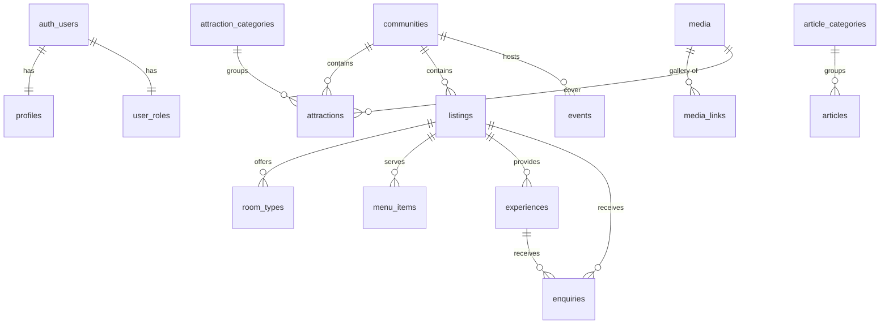

# Database schema (Phase 1)

Source of truth: `supabase/migrations/`. Seed (structure only, no invented facts): `supabase/seed.sql`.

## Tables
| Table | Purpose | Public read |
|---|---|---|
| `profiles`, `user_roles` | Person details; role (separate table so users cannot edit it) | Own row; staff read all |
| `communities` | Towns and villages (10 Lake Bosomtwe-area names seeded as **drafts**) | Published |
| `attraction_categories`, `attractions` | Directory of places to see | Published |
| `listings` | Hotels, restaurants, tour operators, guides, boats, artisans… (`type` enum) | Published |
| `room_types`, `menu_items` | Child data of a listing | If parent is published |
| `experiences` | Tours and activities; `provider_verified` gates "confirmed" claims | Published |
| `events` | Dated events; `event_status` separate from publication `status` | Published |
| `article_categories`, `articles` | Editorial; `published_at` in the future = scheduled | Published and date reached |
| `pages` | About, Explore, Travel Guide, Privacy, Terms (Markdown) | Published |
| `testimonials` | Only `is_verified` + published are shown | Verified + published |
| `media`, `media_links` | File metadata and gallery links | Yes |
| `enquiries` | Contact, booking requests, listing/partnership requests | **No** (insert only) |
| `newsletter_subscribers` | Email list | **No** (insert only) |
| `site_settings`, `homepage_sections` | CMS-managed configuration. Never store secrets here | Yes |
| `audit_logs` | Trigger-written change history | Admins only |
| view `public_authors` | Name/avatar of authors of published articles only | Yes |

## Conventions
- UUID primary keys; `created_at`/`updated_at` maintained by trigger.
- Soft delete via `deleted_at` on content tables; RLS hides soft-deleted rows from the public.
- `status`: `draft` → `pending_review` (in review) → `approved` → `published` → `archived`.
- Latitude/longitude are nullable with range checks. They are never defaulted or guessed.
- Currency columns default to `GHS`; no exchange rates are stored.
- `sources` (attractions/communities) is a **public** field shown on the page. RLS cannot hide single columns, so it is deliberately not an internal note.

## Row Level Security summary
| Actor | Can |
|---|---|
| Anonymous | Read published content; insert into `enquiries` / `newsletter_subscribers` (status forced to `new`) |
| Visitor / partner | Same as anonymous, plus read/update own profile and read own role |
| Content editor | Create/update content drafts and media; cannot approve, publish or verify; no deletes; cannot change `is_verified`, `is_featured`, `owner_id` on listings (DB triggers) |
| Regional editor | Content editor + approve, publish, verify, manage regions and districts |
| Media manager | Media library only |
| Admin | Regional editor + delete content, read audit log, manage settings, read users |
| Super admin | Admin + change user roles |

Verified by running both migrations plus an RLS test script (24 checks) against a throwaway Postgres: anonymous cannot read drafts, future-dated articles, unverified testimonials, enquiries, roles or audit logs; a visitor cannot promote themselves; an editor cannot delete or verify; only a super admin can change roles.

## Phase 2 additions (migration `20261109000001`)
| Item | Purpose |
|---|---|
| `subscription_plans` | Admin-editable plans (price optional, photo limit, featured/analytics flags) |
| `listings.plan_id` | Plan assigned by an admin |
| `profiles.business_account_type` | Partner type; set once |
| `listing_views` + `record_listing_view()` | Daily view counts; anyone can record a view of a published listing, only the owner/staff can read |
| `become_partner(type)` | visitor → partner, requires verified email; the only way to get the partner role |
| Policies | Owners read/insert/update own listings (cannot publish/verify/feature/plan), manage own rooms/menu/gallery, read enquiries about own listings, upload to `partners/<uid>/` |

## Phase 3 additions (migration `20261110000001`)
| Table / function | Purpose |
|---|---|
| `bookings` | Request-based bookings (accommodation, experience, table). Reference `VLB-XXXXXXXX`; price set only by provider/staff; status + payment status |
| `booking_status_history` | Every status change with actor |
| `booking_payments` | Gateway transactions (reference, amount, currency, method, provider response). Written only by server code |
| `room_blocked_dates` | Provider-blocked dates (availability). Active bookings also consume `room_types.units` |
| `reviews` | One per completed booking; moderated (`pending/published/rejected`); owner reply |
| `subscription_plans.commission_percent` | Commission recorded at payment time |
| Functions | `create_booking`, `set_booking_status`, `lookup_booking`, `guest_cancel_booking`, `submit_review`, `reply_to_review`, `can_manage_booking`, `room_available` |
| Access | No direct writes to booking tables. Customers see bookings by reference+email (or their account), providers see bookings for their own listings, staff see all |

## Phase 4 additions (migration `20261111000001`)
| Item | Purpose |
|---|---|
| `travel_itineraries` | A user's plan (days, travellers, interests, optional `share_token`). Owner-only; max 20 per user |
| `itinerary_items` | Items by day/order: a published attraction, listing, experience, event, community, or a custom line. Max 100 per plan |
| `itinerary_view(id, token)` | Resolves a plan for its owner or a share-token holder, against **published** content only (unpublished items show as "no longer available", no title) |
| `nearby_places(lat, lng, radius, limit)` | Great-circle distance search over published items that have coordinates |

## Phase 5 additions (migration `20261112000001`)
| Item | Purpose |
|---|---|
| `investment_opportunities` | Projects with `stage` (operational/approved/proposed/under_consideration). CHECK: approved/operational need `stage_source`; estimates need `investment_note` and min ≤ max |
| `enquiries.investment_id` | Investor enquiries point at a project |
| `advertisements` | Sponsored placements; visible publicly only when published and inside `starts_at..ends_at`; admins only can write |
| `record_ad_event()` | Only way to bump `impressions`/`clicks`; counts only live ads |

## Planned tables (later phases)
Phase 4: `travel_itineraries`, `itinerary_items`, `saved_places`. Phase 5: `investment_opportunities`, `investor_enquiries`, `advertisements`, `advertisement_campaigns`.

## VisitAsanteman Phase 1 additions (migrations `20261113000001` to `20261113000003`)
Geography: **Region → Administrative area (MMDA) → Community → Locality.** Traditional areas are a separate many-to-many overlay.

| Item | Purpose |
|---|---|
| `regions` | Ashanti row seeded. `source`, `source_url`, `verified_at` record where a record came from |
| `administrative_areas` | Metropolitan, municipal and district assemblies. Migration `20261113000004` loads 43 rows **inactive and unverified** from a secondary source; they must be checked and activated by a regional editor. Public read when `is_active` |
| `traditional_areas`, `community_traditional_areas` | Optional overlay; status workflow and verification fields, culturally sensitive |
| `localities` | Optional neighbourhoods inside a community |
| `destinations` | A place worth planning a trip around (e.g. Lake Bosomtwe), always inside one administrative area |
| `administrative_area_id` | Added to communities, attractions, listings, events, experiences (`on delete restrict`) |
| `destination_id` | Added to attractions, listings, events, experiences, articles (`on delete set null`) |
| `last_verified_at`, `verification_notes` | Added to communities, attractions, listings, events, experiences (and destinations, traditional areas) |
| `content_revisions` | Previous version of a row each time it changes (communities, attractions, listings, experiences, events, articles, pages, destinations, traditional areas). Readable by staff only; written only by trigger. `audit_logs` remains admin-only |
| Enum additions | `app_role`: `regional_editor`, `media_manager`. `content_status`: `approved` |

Triggers (run in this order on content tables): `tg_a_derive_area` (area from community or destination), `tg_b_publish_area` (no publishing without an active area), `tg_c_workflow` (approve/publish needs `can_approve()`), `tg_d_verification` (only approvers change verification flags), `tg_e_revision`. `auth.uid()` being null (migrations, service role, direct SQL) is treated as a non-user session and skips the role checks; end users never do.

Not done in this phase: a separate `scheduled` status, restoring a revision from the admin, per-district scoping of regional editors (a regional editor currently works across the whole region).

## VisitAsanteman Phase 2 additions (migrations `20261114000001`, `20261114000002`)
Research, verification and access are separate ideas: a fact can be established while the site is closed or only proposed.

| Item | Purpose |
|---|---|
| `verification_status` (attractions) | `research_identified` → `awaiting_verification` → `verified_secondary` → `officially_confirmed`. **A record cannot be published unless it is one of the two verified levels** (trigger `guard_attraction_research`). Only approvers can set a verified level |
| `access_status` | `unknown`, `open_to_visitors`, `permission_required`, `restricted_access`, `temporarily_unavailable`, `permanently_closed`, `proposed`. Shown on the public page; anything except plain "open" displays a notice |
| `access_notes`, `managing_institution` | Public: permits, etiquette, photography rules, responsible body |
| `source_organisation`, `source_url`, `source_published_at`, `researched_at`, `reviewed_by`, `research_notes` | Source tracking. The first four and the access fields are shown publicly where present; `research_notes` is internal |
| `alt_names` | Alternative spellings on attractions, communities and districts. Recorded; public search does not match them yet |
| Inventory load | 52 attraction records from the owner's research summary (citing the ARCC Regional Profile 2023) loaded as **draft / research_identified / access unknown**, with no coordinates, descriptions, hours, fees or contacts. 16 are linked to a district where the summary names one and it matches the working district list. The ARCC document itself could not be reached, so none of it has been checked against it |

Only attractions have the verification gate so far. Other record types (hospitality, education, sports, transport, markets, ceremonies) are later phases.
