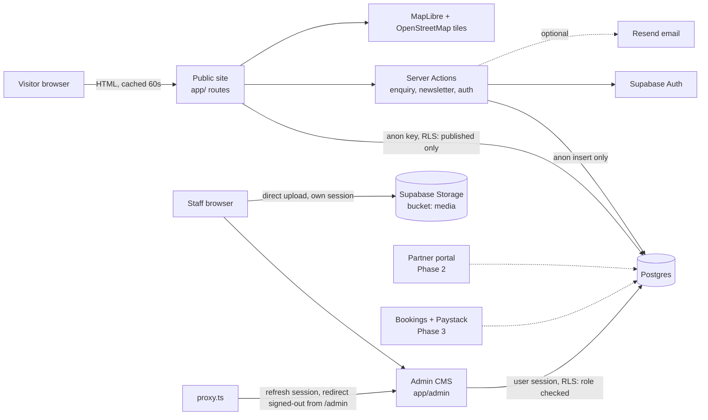

# System architecture

## Shape: a modular monolith
One Next.js app, deployed to Vercel, talking to one Supabase project. No microservices. Module boundaries are folders, so a module can be split out later without a rewrite.

## Layers and where code lives
| Layer | Location | Notes |
|---|---|---|
| Public pages | `app/*` | Server Components, `revalidate = 60`, JSON-LD, metadata |
| Public data access | `lib/content/public.ts` | Cookie-free anon client so pages can be cached; RLS returns published rows only |
| Auth + roles | `lib/auth/session.ts`, `proxy.ts`, `app/actions/auth.ts` | Role always read from DB |
| Admin CMS | `app/admin/*`, `config/admin-resources.ts`, `lib/admin/parse.ts` | One config object drives list/create/edit/validation for every content type |
| Forms | `app/actions/forms.ts`, `lib/validations/forms.ts` | Zod validation, honeypot, rate limit, saved before success is reported |
| Database | `supabase/migrations/*` | Schema, RLS, storage policies, audit triggers |
| Maps | `components/maps/*` | MapLibre (free). Swap for Google/Mapbox by replacing one component |

## Key decisions and trade-offs
1. **Custom admin, not Payload/Sanity.** Required by the brief. Costs more build time, but there is one auth system and one database. The config-driven design keeps the cost of adding a content type to roughly one config entry.
2. **One `listings` table** for hotels, restaurants and all other businesses (`type` enum) plus child tables (`room_types`, `menu_items`). Avoids three near-identical tables and three CRUD stacks, and gives Phase 2 a single place to attach owners and subscriptions.
3. **Shared `media` table** + `media_links` (polymorphic gallery) instead of one image table per entity.
4. **RLS is the security boundary.** The app uses the anon key or the signed-in user's session everywhere. The single exception is the payment module, which uses the service-role key (server only) to record payments that the gateway has verified. Server-side role checks are a second layer.
5. **Direct-to-Storage uploads from the staff member's browser**, with client-side resize to WebP. This avoids Vercel's ~4.5 MB request limit. The bucket enforces size and MIME type; RLS enforces staff-only.
6. **MapLibre + OpenStreetMap** for launch: free and no API key. OSM's public tile server has a usage policy, so move to a tile provider (MapTiler/Stadia/Mapbox) before heavy traffic.
7. **Enquiry-based booking first.** `enquiries` holds requests; nothing is auto-confirmed. `room_types` and the experience fields are already shaped for availability and payments.
8. **Markdown, not a WYSIWYG editor,** for article/page bodies. Rendered without raw HTML, so editor content cannot inject scripts. A rich editor can be added later without a schema change.

## Request flows
- **Public page:** browser → Next (cached) → anon Supabase query (RLS) → HTML.
- **Enquiry:** form → server action → Zod → honeypot → rate limit → anon `insert` (RLS allows insert only) → optional email → success message. A failed insert shows an error, never a fake success.
- **Admin save:** form → server action → `requireStaff()` → parse/validate → user-session write (RLS re-checks role) → cache flush → redirect.
- **Image upload:** browser resizes → uploads to Storage (RLS staff) → inserts `media` row → id goes into the form → saved with the content.

## Bookings and payments (Phase 3)
Customers call database functions (`create_booking`, `lookup_booking`, `guest_cancel_booking`, `submit_review`) that validate everything; no client has write access to booking tables. Providers and staff change status only through `set_booking_status`, which enforces a state machine and ownership. `lib/payments` verifies payments with Paystack server-side and is the only code using the service-role key. See PAYMENTS.md.

## Planner and AI (Phase 4)
Plans are owner-only rows; sharing uses an unguessable token resolved by `itinerary_view`. The AI assistant (`lib/ai`) is **grounded**: it receives a catalogue of published items, must answer in JSON, and every id it returns is checked against that catalogue; unknown ids are dropped and free text is stripped of markup, so it cannot invent businesses, prices or activities. It is rate-limited and off unless configured.

## PWA
`app/manifest.ts`, `public/sw.js` and `/offline`. The service worker caches public pages only and never touches admin, partner, booking, account, auth, planner or API requests.

## Investment and advertising (Phase 5)
Investment pages always show the project's real stage and a notice for concepts; the database refuses to store "approved/operational" without a source. Ads are rendered by `AdSlot` with a "Sponsored" label; clicks go through `/api/ads/[id]/click`, which counts and redirects only for live ads to http(s) URLs.

## Not built yet (by design)
Multilingual support, Hubtel, downloadable investment briefs. See the roadmap.

## Regional layer (VisitAsanteman Phase 1)
- **Geography is the spine.** Region → administrative area (MMDA) → community → locality, with destinations (e.g. Lake Bosomtwe) inside one area and traditional areas as an optional overlay. Every publishable item carries an `administrative_area_id`; a database trigger refuses to publish without an active one.
- **Public routes:** `/districts`, `/districts/[slug]`, `/destinations`, `/destinations/[slug]`, culture hub pages (`/culture/*`, CMS-managed and showing "being prepared" until written), `/advertise`, `/partner-with-us`, `/about/our-mission`, `/about/partners`. Existing directories gained a **District** filter (`?area=<slug>`). Data access for all of it is in `lib/content/public.ts` (`listAreas`, `getArea`, `listDestinations`, ...).
- **Editorial workflow and roles** are enforced by database triggers and RLS (see AUTHENTICATION); the admin only mirrors them.
- **Brand in one place:** `config/site.ts` (names, tagline, menu) and `components/brand/Wordmark.tsx` (the logo; text wordmark until a real logo exists).
- **Redirects:** `config/redirects.ts`, applied by `next.config.ts`. The canonical origin always comes from `NEXT_PUBLIC_SITE_URL`.
- **Design tokens** still use the names `lake` for the blue accent (#287D9B). Those are internal CSS variable names, not visible branding.
